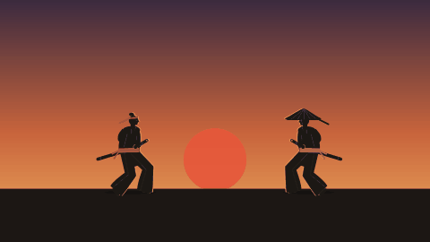
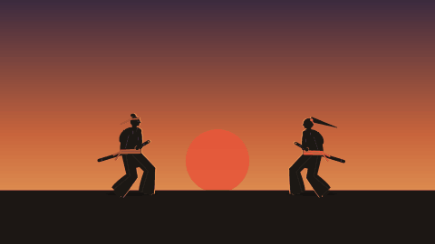
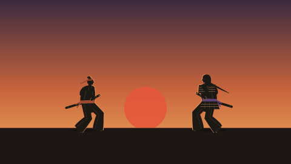
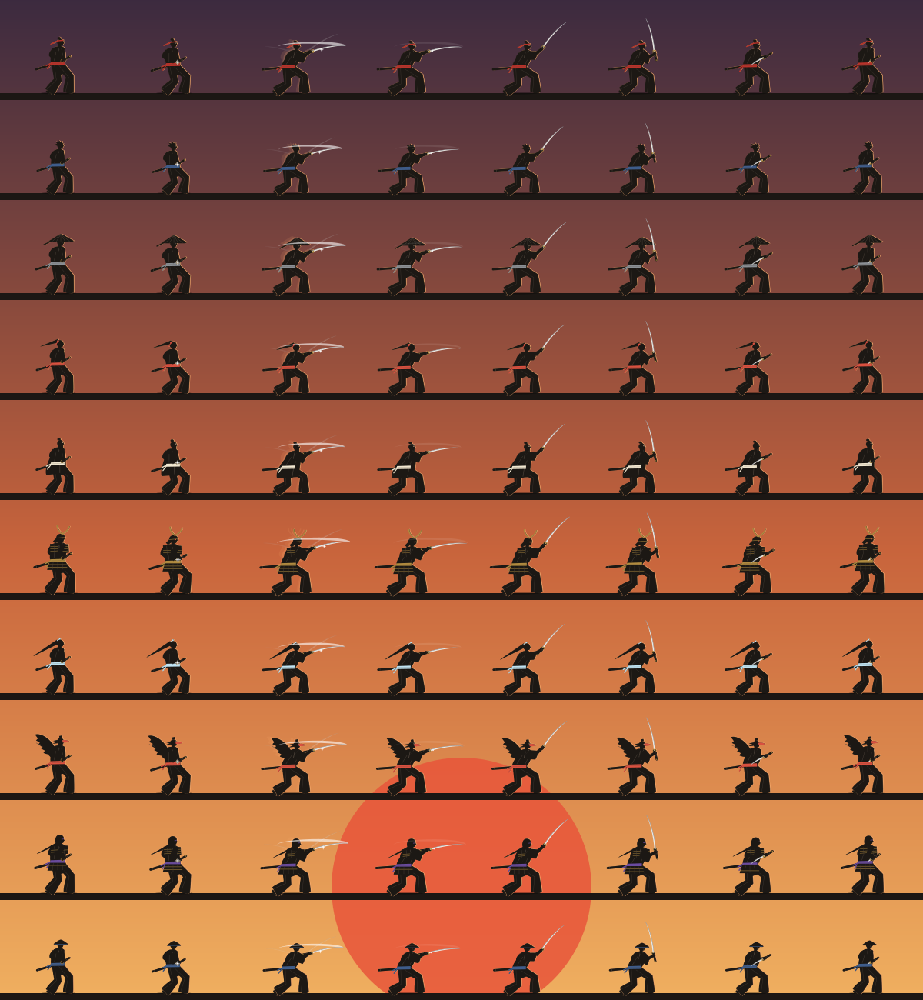
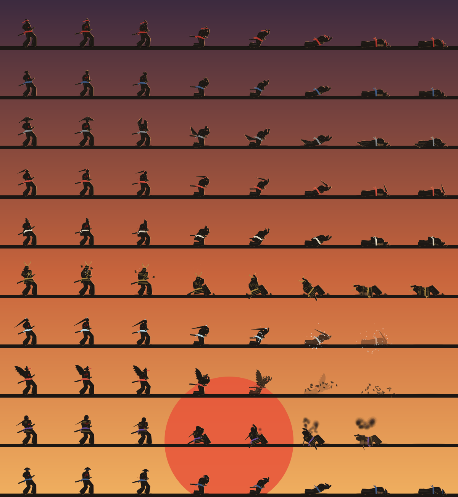

# IAI – Duelo Samurai (居合)


Um sinal. Um golpe. Uma chance.

O celular vira a sua katana. Espere em silêncio e, quando o sinal aparecer, **corte o ar** o mais rápido que puder. Quem sacar primeiro vence.

<p align="center">
  
  
  
</p>

**Versão 2.1** (25/11/2026): mortes com física (joelhos cedendo, tombo, espada caindo), saque e noto mais realistas, personagens mais detalhados e um fim próprio para cada chefe sobrenatural.

**Versão 2.0** (25/11/2026): chefes com regras próprias, modo Hordas, história em mangá, loja, conquistas, Iai Perfeito e testes automáticos.

## Modos
- **Duelo (決闘)**: "O Caminho" com 8 oponentes, cada um com uma história em painéis de mangá antes e depois da luta. Vencer um oponente libera o próximo.
- **Hordas (波)**: sobreviva a ondas de inimigos com 3 vidas (命). A cada onda os inimigos ficam mais rápidos, surgem modificadores e, a cada 5 ondas, aparece um chefe.
- **Dois jogadores (対戦)**: os dois alternam no mesmo celular, 3 tentativas cada. Vence o melhor tempo.
- **Treino (修行)**: cortar o makiwara e medir o tempo de reação, com recorde.
- **Loja (店)**: troque moedas por faixas (obi) e lâminas com rastro colorido.
- **Conquistas (誉)**: 12 carimbos hanko, cada um com recompensa em moedas.
- **Registros (記録)** e **Ajustes (設定)**.

## Os chefes e suas regras
| Oponente | Regra | Como funciona |
|---|---|---|
| Taro, o Aprendiz | nenhuma | Aprendiz, às vezes se precipita |
| Ronin | 偽 Finta | Um sinal falso (cinza, tremendo) aparece antes. Cortar nele é desonra |
| Akane | 閃 Relâmpago | O sinal some rápido |
| Gensai, o Mestre Cego | 聴 Só o som | Sem sinal visual: o som toca mesmo com o som desligado |
| Kurogane, o Oni | 鎧 Armadura | É preciso vencer 3 golpes |
| Yuki, a Dama da Neve | 吹 Nevasca + 偽 Finta | Arena na neve, a nevasca esconde a tela |
| Tengu, o Corvo da Montanha | 止 Pare + 閃 Relâmpago | Aparece 止: quem cortar perde o golpe |
| Kage, o Shogun das Sombras | 偽 + 止 + 鎧 | Arena noturna, duas fintas, pare e armadura. O chefe final |

## Hordas
- Inimigos (ashigaru, bandidos e desertores) entram andando, um após o outro.
- **Combo**: cada corte seguido aumenta o multiplicador de pontos (até ×3).
- **Iai Perfeito** recupera uma vida.
- Modificadores por onda: 夜 Noite, 吹 Nevasca, 偽 Fintas, 止 Pare e 急 Pressa.
- Chefes a cada 5 ondas (Ronin → Kage). Os chefes com armadura precisam de 2 cortes.
- O jogo guarda a melhor onda, a melhor pontuação, as baixas e o maior combo.

## Iai Perfeito (極)
Um corte em até **260 ms** é um Iai Perfeito: vale dois golpes no duelo, dá moedas extras e ativa uma câmera lenta dourada.

## Animações
Tudo é desenhado com Canvas, sem nenhuma imagem, em um esqueleto com cinemática inversa nos braços e nas pernas.

- **Saque (iai):** o polegar solta a guarda (koiguchi) e ela brilha, a lâmina sai com um brilho correndo pelo aço e uma estrela na ponta no impacto. Depois vêm o zanshin, o chiburi (sacudir a lâmina) e o noto: a ponta vai até a boca da bainha e a lâmina desliza para dentro.
- **Morte:** um instante parado depois do corte, cambaleio, os joelhos cedem e o corpo tomba acelerando como na gravidade, quica no chão e levanta poeira. Os braços perdem a força e a espada escapa da mão, gira e fica no chão. Quem usa armadura pesada cai de costas.
- **Fim dos chefes:** Kage se desfaz em fumaça, Yuki vira neve, Tengu explode em penas e a armadura do Oni racha e solta pedaços.
- **Detalhes:** olhos que piscam e mudam de expressão (foco, susto, fechados), mãos fechadas no cabo ou abertas, hakama com pregas e barra em sino, sandálias, habaki dourado na lâmina.
- **Movimento:** respiração, peso passando de um pé para o outro, física de corrente (Verlet) em faixas, cabelo e cachecol, câmera com hit-stop e câmera lenta, e 3 arenas (entardecer, neve e noite).

| Golpe quadro a quadro | Morte quadro a quadro |
|---|---|
|  |  |

## Sensores usados
| Sensor | Para quê |
|---|---|
| Aceleração linear | Detecta o golpe (sem ela, usa o acelerômetro com filtro) |
| Giroscópio | Confirma que o celular girou no corte |
| Toque ou proximidade + luz (opcional) | **Modo bainha**: soltar antes do sinal é desonra |
| Microfone (opcional) | **Modo palma**: uma palma de verdade é o sinal |
| Vibração | Impacto, vitória, derrota, finta e precipitação |

O tempo de reação usa o **timestamp do próprio evento do sensor** (`elapsedRealtimeNanos`), não o momento em que a tela atualiza.

## Testes e CI
Os testes de unidade (JUnit) ficam em `app/src/test` e cobrem:
- o plano de fintas e do "pare";
- o motor das Hordas;
- a loja e as conquistas;
- as regras dos chefes;
- a linha do tempo do golpe;
- a linha do tempo da morte e do noto.

O GitHub Actions (`.github/workflows/android.yml`) roda `testDebugUnitTest` e `assembleDebug` a cada push e publica o APK na página de [versões](https://github.com/Gui-Mestriner01/iai-duelo-samurai/releases/latest), pronto para baixar no celular.

```
./gradlew testDebugUnitTest assembleDebug
```

## Tecnologia
Kotlin, Jetpack Compose, Material 3, Navigation Compose, MVVM, Coroutines/Flow e DataStore.

Os sons do jogo são **sintetizados no código** (taiko, sinal, finta, gongo, corte, sino). Os sons de quando alguém é cortado ficam em `res/raw` e tocam com `SoundPool`. Neste repositório público, o som dos oponentes comuns usa o mesmo corte do Oni.

Fontes: Yuji Boku e Shippori Mincho B1 (SIL Open Font License, em `licenses/`), recortadas só com os caracteres usados.

## Estrutura
```
com.gui.iai
├── core/        AppContainer (DI manual), fábrica de ViewModels
├── data/        DataStore: ajustes, registros e progresso (moedas, itens, conquistas)
├── domain/      Oponentes e regras, Hordas, Loja, Conquistas, História, Recompensas
├── sensors/     SwingDetector, ScabbardSensor
├── audio/       ClapDetector, SoundEngine, CutVoices
├── haptics/     Padrões de vibração
├── game/        RoundRunner, CuePlan (fintas e pare), Feedback
└── ui/
    ├── theme/       cores, fontes
    ├── components/  samurais, física e cena do duelo
    ├── story/       painéis de mangá
    ├── horde/       modo Hordas
    ├── game/ duel/ versus/ training/ menu/ navigation/
```

## Como testar
1. Rodar pelo Android Studio (Run) com o celular na Depuração USB, ou instalar o APK.
2. **Treino**: segure o celular como o cabo de uma espada, espere o "!" e corte o ar. Se o corte não for detectado, use a sensibilidade **Leve**.
3. **Duelo**: comece pelo Taro e leia as regras de cada chefe antes da luta.
4. **Hordas**: na tela inicial, toque em Hordas e veja até que onda você chega.

> Os tempos incluem o atraso da tela (~16–30 ms) e dos sensores, então servem para comparar, mas não são um tempo de reação "de laboratório".
